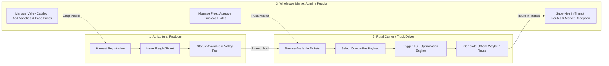
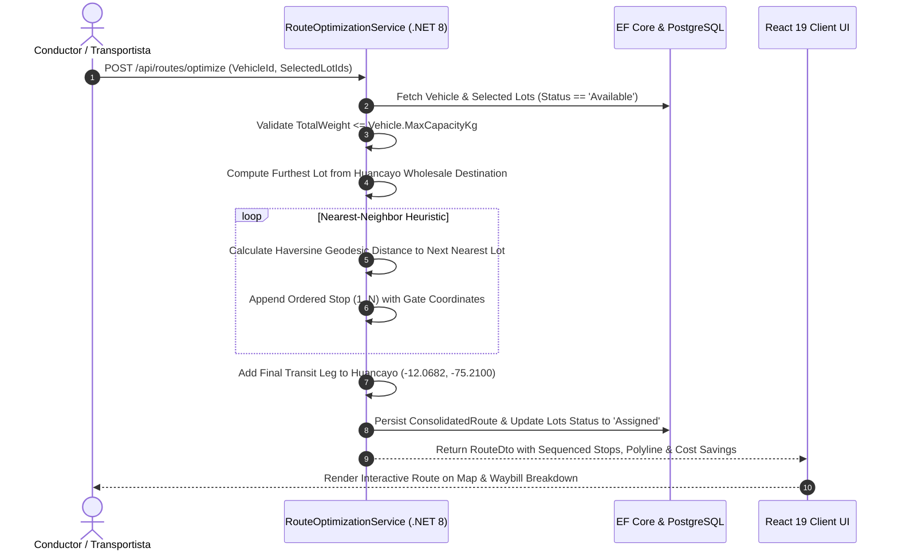

# AgroConecta Mantaro · Systems Architecture & Domain Flows

> **UPLA 2026-II Hackathon · Track 2: Systems Integration**  
> **Topic:** Option 4 — Intelligent Geospatial Routing & Shared Agricultural Freight Platform in the Mantaro Valley.

---

## 1. Domain Model: Decoupled Multi-Role Logistics Marketplace

The platform implements a decoupled, event-driven logistics marketplace tailored to rural Andean logistics:

---

## 2. Core Entities & Lifecycle States

### 2.1 Harvest Ticket (`HarvestLot`)
Represents an offer of agricultural cargo waiting at a farm gate (*tranquera*).
* **Identifier:** Primary key (`Id`) and Ticket Code (`TCK-{Id}`).
* **Payload Attributes:** `WeightKg`, `CropType`, `EstimatedPricePerKg`.
* **Spatial Attributes:** `Latitude`, `Longitude`, `TownName` (Euclidean-derived), `LocationSource` (e.g. *Parcela Santa Rosa*).
* **Lifecycle:**
  $$\text{Available} \xrightarrow{\text{Carrier Consolidates}} \text{Assigned} \xrightarrow{\text{Farm Gate Pickup}} \text{InTransit} \xrightarrow{\text{Wholesale Weighbridge}} \text{Delivered}$$

### 2.2 Vehicle & Payload Unit (`TransportVehicle`)
* **Identifiers:** `LicensePlate`, `DriverName`, `ContactPhone`.
* **Payload Capacity:** `MaxCapacityKg` (e.g., 4,000 kg for 2-axle trucks; 8,000 kg for medium freight).
* **Live Payload:** `CurrentLoadKg`, `IsAvailable`.

### 2.3 Consolidated Waybill (`ConsolidatedRoute`)
* **Mathematical Optimization:** Heuristic Traveling Salesperson Problem (TSP) with Nearest-Neighbor geodesic ordering from furthest valley plot (*Jauja/Concepción*) inward through intermediate gates (*Mito, Orcotuna, Sicaya, Chupaca*) terminating at the **Gran Mercado Mayorista de Huancayo (Puquio)**.
* **Waybill Attributes:** `TotalDistanceKm`, `EstimatedDurationMinutes`, `TotalWeightKg`, `Stops` (sequenced 1 to $N$).
* **Cost Efficiency Model:** Shared freight pro-rata calculation yielding 30% to 35% savings compared to private exclusive charters.

---

## 3. Heuristic Vehicle Routing Engine (`RouteOptimizationService`)

